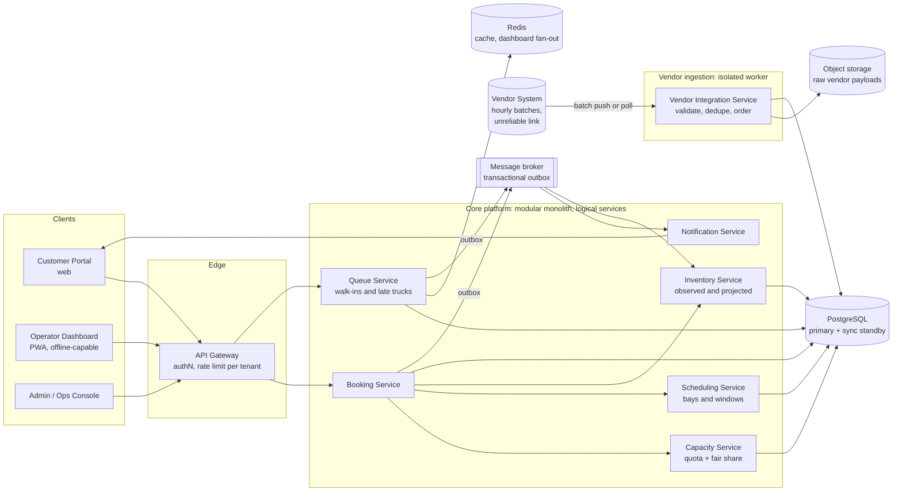
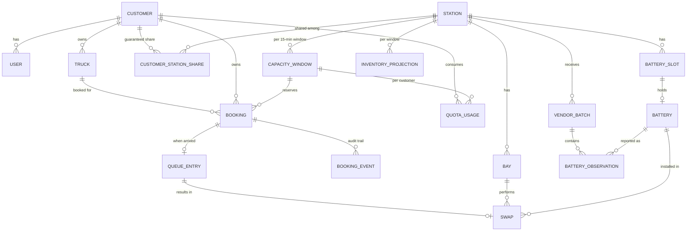
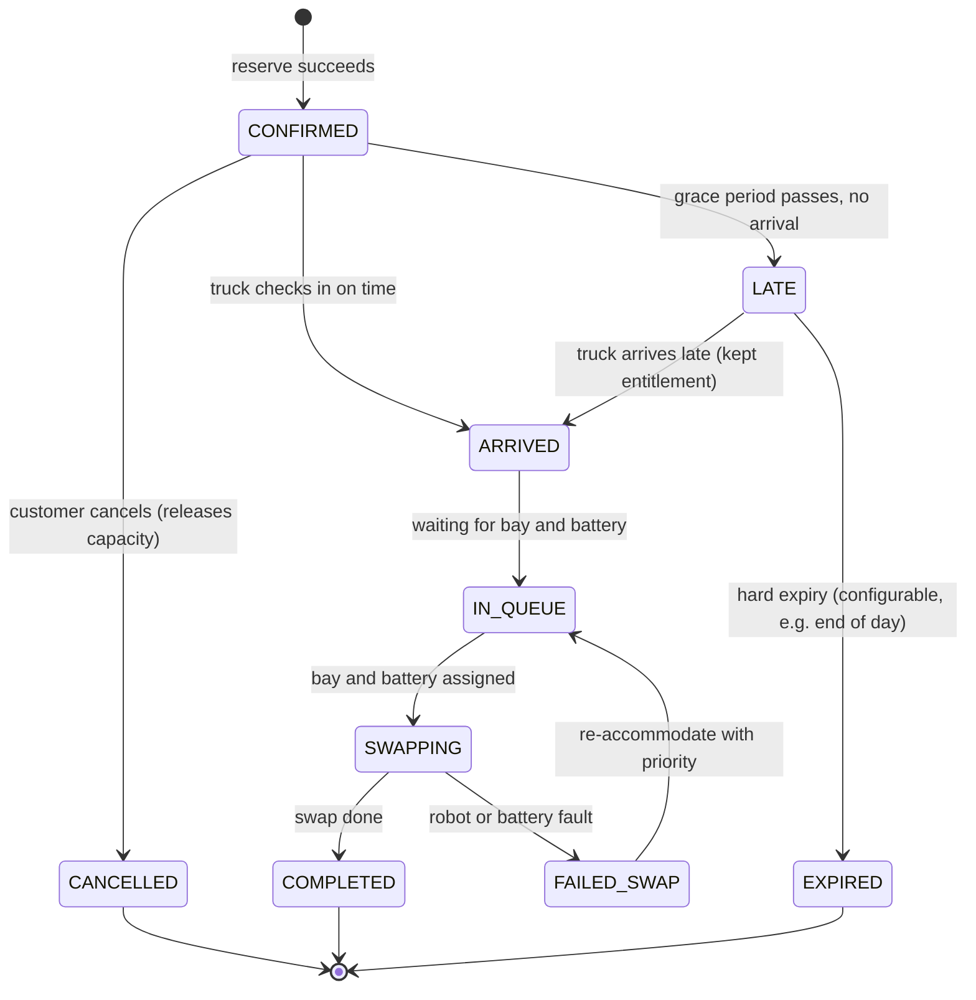

# Energy-In-Motion System Design Assignment 

## A. Architecture




---

## B. Data Model

### B.1 Entity relationship diagram



### B.2 Core tables

All tenant-scoped tables carry `customer_id` and are protected by Row-Level Security.

| Table | Key columns | Notes |
|---|---|---|
| `customers` | `id`, `name`, `status` | Tenant root |
| `users` | `id`, `customer_id`, `role` | Portal users; operators and admins are separate roles |
| `trucks` | `id`, `customer_id`, `plate`, `battery_class` | Authorization check: truck must belong to the booking customer |
| `stations` | `id`, `name`, `tz`, `bay_count`, `slot_count`, `status` | Static plus operational status |
| `bays` | `id`, `station_id`, `status` (`OK`/`DOWN`/`MAINT`) | Robot health drives bay capacity |
| `battery_slots` / `batteries` | `id`, `station_id`, `state`, `soc`, `charge_started_at`, `charge_eta` | **Internal only**; never exposed to customers |
| `customer_station_share` | `customer_id`, `station_id`, `share_pct`, `effective_from` | Guaranteed share; sum of shares ≤ 100% minus walk-in reserve |
| `capacity_window` | `station_id`, `window_start` (15 min), `bay_budget`, `battery_budget`, `committed`, `walkin_reserve`, `version` | **The contended row**; the unit of reservation |
| `quota_usage` | `customer_id`, `station_id`, `window_start`, `guaranteed_limit`, `used_guaranteed`, `used_shared` | Fair-share accounting per window |
| `bookings` | `id`, `public_ref`, `customer_id`, `truck_id`, `station_id`, `window_start`, `status`, `class` (`GUARANTEED`/`SHARED`), `idempotency_key`, `created_at` | Unique on `(customer_id, idempotency_key)` |
| `booking_events` | `booking_id`, `type`, `at`, `actor`, `payload` | Append-only audit trail |
| `queue_entries` | `id`, `station_id`, `booking_id` (nullable for walk-ins), `priority_class`, `arrived_at`, `status` | Operational queue |
| `swaps` | `id`, `queue_entry_id`, `bay_id`, `battery_id`, `started_at`, `completed_at`, `outcome` | Our own **swap ledger**; feeds the projection |
| `vendor_batches` | `station_id`, `vendor_batch_id`, `observed_at`, `received_at`, `status` (`APPLIED`/`DUPLICATE`/`STALE`/`QUARANTINED`) | `UNIQUE (station_id, vendor_batch_id)` for dedupe |
| `battery_observations` | `batch_id`, `battery_id`, `state`, `soc`, `observed_at` | Raw observed view |
| `inventory_projection` | `station_id`, `window_start`, `projected_charged`, `confidence`, `computed_at`, `based_on_batch_id` | Projected view with confidence |
| `idempotency_keys` | `customer_id`, `key`, `request_hash`, `response`, `created_at` | Safe retries |
| `outbox` | `id`, `topic`, `payload`, `created_at`, `published_at` | Transactional outbox |
| `audit_log` | `actor`, `tenant_id`, `action`, `target`, `at` | Security and cross-tenant admin actions |

### B.3 Booking flow



`LATE` is **not** a cancellation. A late booking keeps its entitlement and is served from the priority queue. `EXPIRED` happens only after a long, configurable hard limit and always triggers a customer notification and a priority re-booking offer.

---

## C. Booking Logic

### C.1 Time model

- Capacity is managed in **15-minute windows** per station. A 5-minute swap means a bay can nominally handle 3 swaps per window.
- Windows give us a small, countable set of rows to lock and reason about, instead of continuous scheduling.
- The windows nearest to "now" use live projections. Windows further out use a **planning budget**.

### C.2 Two-layer capacity model

Each station window has a bookable capacity `C(w)` that is the **minimum of three things**:

```
bay_budget(w)      = floor( healthy_bays × (15 min ÷ 5 min) × (1 − walkin_and_late_reserve) )
battery_budget(w)  = min( planning_budget(w) , live_headroom(w) )   # see below
C(w)               = min( bay_budget(w) , battery_budget(w) )
```

**Layer 1: planning budget (day-ahead, independent of live vendor data).** The steady-state battery supply per window is `battery_slots × (15 ÷ charge_minutes)`, reduced by a safety haircut and by the seasonal charge-time factor. This guarantees that a day's bookings are feasible in the long run even when we have no live data. Because it does not depend on the vendor feed, **vendor outages do not block far-future bookings**.

**Layer 2: live feasibility (near-term, roughly the next 3–4 hours).** For windows inside this horizon, we also need the cumulative battery check:

```
supply_by(w)    = batteries confirmed charged at last snapshot
                + batteries whose pessimistic charge ETA ≤ w.start
                − batteries faulted or reserved for walk-in margin
committed_by(w) = bookings already confirmed in windows ≤ w
                + floating claims (late trucks still entitled)
headroom(w)     = supply_by(w) − committed_by(w)
```

A booking at window `w` consumes one battery from `w` onwards, so it is admitted only if `headroom(w') ≥ 1` for **every** `w' ≥ w` inside the live horizon. We use **pessimistic** ETAs (p90 charge time, longer in summer).

### C.3 Freshness tiers (how stale data reduces booking aggressiveness)

Thresholds are configurable and are tuned from measured drift (see H).

| Tier | Time since last applied vendor batch | Behaviour for **new** bookings |
|---|---|---|
| **Fresh** | ≤ ~90 min (hourly batch + grace) | Normal admission using projection with a standard haircut |
| **Stale** | ~90 min to ~4 h | Count only batteries confirmed charged at the snapshot minus our own swap ledger; give no credit for unconfirmed charge completions; larger haircut; require headroom ≥ 2 |
| **Blind** | > ~4 h | No new bookings inside the live horizon; far-future bookings only via the reduced planning budget; alert operations |

**Existing confirmed bookings are never cancelled because data went stale.** Staleness only throttles *new* admissions. We are never fully blind: our own swap ledger records every completed swap, so the projection can keep subtracting real consumption even without a vendor batch. The main uncertainty during an outage is charging progress and unrecorded swaps.

### C.4 Customer fair share (guaranteed, shared, opportunistic)

For station `s`, window `w` and customer `c`:

```
G_c(w) = floor( share_c × C(w) )          # guaranteed slots, largest-remainder rounding so totals are exact
Pool(w) = C(w) − Σ_c G_c(w)               # shared / unallocated (also includes walk-in reserve policy)
```

Admission for customer `c`:

1. **Guaranteed:** if `used_c(w) < G_c(w)`, admit as `GUARANTEED`. This is always safe because `G_c` is carved out of `C(w)`.
2. **Shared:** otherwise, if the shared pool has room, admit as `SHARED`.
3. **Borrowed:** after the **release time** `R(w)` (for example 2 hours before the window), other customers' *unused* guaranteed slots flow into the shared pool and can be taken first-come-first-served.
4. **Reject with alternatives:** otherwise decline and offer the nearest windows, nearby stations, or a waitlist entry.

Key points:

- **Per-window quotas, not per-day only.** Otherwise one customer could consume all the shift-change peak slots while still being "within its daily share".
- **Lending is irreversible.** Once a borrowed booking is confirmed it is never revoked, so lending uses only capacity whose owner has had a fair chance to book (before `R(w)`). This protects "no booked truck turned away" and "guaranteed share" at the same time.
- Opportunistic capacity (cancellations, no-shows, slack) is released into the shared pool and offered through the waitlist.

### C.5 Concurrency control (no double booking)

Because there are only 30 stations and a low write rate, the simplest correct approach is **serialize reservations per station inside one transaction**:


- A per-station lock makes the "last slot" race impossible and keeps the multi-row headroom check (all `w' ≥ w`) correct, which per-row optimistic updates struggle with.
- At a few bookings per second across 30 stations, lock contention is negligible. If a single hot station ever becomes a bottleneck, move to per-window row locks with `version` checks (optimistic concurrency) and retry.
- A `UNIQUE (customer_id, idempotency_key)` constraint plus the stored response makes client retries safe.
- Cancellation runs the reverse transaction under the same lock, and a released slot can trigger a waitlist promotion.


### C.6 Arrival, walk-in and late-arrival logic (the execution queue)

**Priority classes** (highest first):

| Class | Who | Rule |
|---|---|---|
| P0 | Booked, arrived within the grace period | Served in window order |
| P1 | Booked, **late** (past grace) | Keeps entitlement; served ahead of walk-ins as soon as a bay and battery are free |
| P2 | Walk-ins | Served from slack capacity; aging prevents starvation |


---

## D. What Happens When Things Fail

This extends the failure table in Part I with detection, behaviour, and recovery.

| # | Failure | Detection | System behaviour | Recovery |
|---|---|---|---|---|
| 1 | **Vendor connection down** | No batch within the expected interval; freshness tier moves Fresh → Stale → Blind | Throttle **new** bookings per freshness tiers; keep honouring existing bookings; keep subtracting our own swap ledger; alert operations | When a batch arrives, rebase the projection; release the throttle |
| 2 | **Duplicate vendor batch** | `UNIQUE (station_id, vendor_batch_id)` | Ignore, mark `DUPLICATE` | None needed |
| 3 | **Old / out-of-order vendor batch** | `observed_at` older than the station's watermark | Mark `STALE`/`QUARANTINED`; never overwrite newer state | Keep for audit and drift analysis |
| 4 | **Malformed or implausible batch** (e.g. battery count jumps) | Schema and sanity validation | Quarantine; do not apply; alert | Manual review or replay from raw payload |
| 5 | **Vendor batch arrives late and shows less inventory than projected** | Drift = projected − observed | Immediately lower headroom; flag bookings that are now **at risk** | At-risk handling (see below) |
| 6 | **Client retries a booking** | Idempotency key | Return the original response; no duplicate | None needed |
| 7 | **Two requests race for the last slot** | Per-station lock | One commits, the other gets alternatives | None needed |
| 8 | **Database primary down** | Health checks | Stop confirming new bookings; fail over to the synchronous standby (no confirmed booking lost); portal shows a "temporarily unavailable" message | Resume after failover and replication check |
| 9 | **Redis down** | Health checks | Dashboards fall back to direct DB reads; no data loss | Rebuild cache |
| 10 | **Broker / notification failure** | Outbox backlog grows | Bookings still confirm; notifications retry from the outbox | Drain outbox |
| 11 | **Robot / bay failure** | Operator report or vendor status | Mark bay `DOWN`; recompute `bay_budget` for affected windows; list **at-risk bookings** | Re-accommodate (below) |
| 12 | **Battery fault or fewer charged batteries than expected** | Operator report or vendor batch | Reduce headroom; queue trucks; booked trucks go first | Re-accommodate (below) |
| 13 | **Station loses power / network** | Heartbeat from dashboard; vendor silence | Operators use the offline PWA (cached next-hours queue) and a paper fallback; record swaps locally | Sync events later using idempotent event IDs; reconcile with vendor batch |
| 14 | **Truck arrives late** | Grace timer | `LATE` state, floating claim, P1 queue | Served; never auto-cancelled |
| 15 | **Peak at shift change** | Queue length and wait-time metrics | Per-window quotas prevent one tenant filling the peak; walk-in rule protects booked trucks; dashboard shows expected wait | Spread demand with alternative windows offered at booking time |
| 16 | **Cross-tenant access attempt** | AuthZ and RLS denial; audit log | Return "not found"; log and alert on repeated attempts | Security review |
| 17 | **Clock skew or timezone errors** | Station `tz` mismatch checks | Store UTC plus station timezone; windows computed server-side | Correct and re-evaluate windows |


## E. What I Would Build First


| Phase | Build | Exit criteria |
|---|---|---|
| **Phase 1** | Auth, **tenant isolation (RLS from day one)**, trucks, stations, booking APIs, public/internal ID separation | Cross-tenant tests all fail closed; battery IDs never appear in any customer response |
| **Phase 2** | Station capacity (bays, planning budget), customer shares and quotas, window model | Capacity numbers match the sustained-throughput formula for each station type |
| **Phase 3** | **Reservation engine** with per-station locking, idempotency, outbox | Load test of hundreds of concurrent requests for the last slot produces exactly one winner and zero oversells |
| **Phase 4** | Vendor integration, observed vs projected inventory, freshness tiers, reconciliation | A vendor **simulator with fault injection** (delay, duplicates, reordering, multi-hour outage) passes without overbooking |
| **Phase 5** | Operator dashboard, queue, walk-ins, swap ledger, offline PWA | A station can run a full shift, including a network outage, from the dashboard |
| **Phase 6** | Late-arrival handling, notifications, at-risk re-accommodation, optimization (forecasting, smarter haircut) | Game-day drills for robot failure and vendor blackout meet recovery targets |


---
